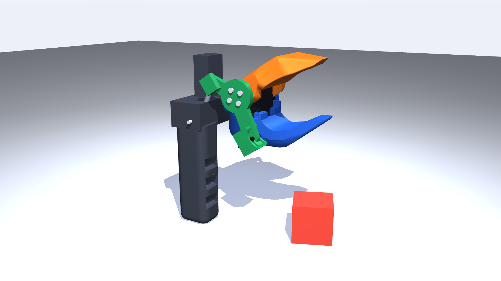
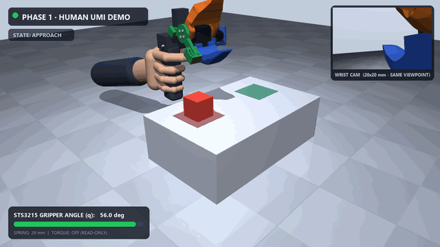
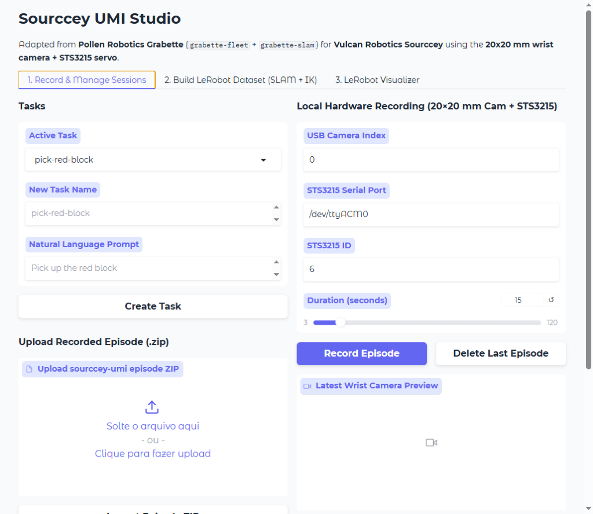
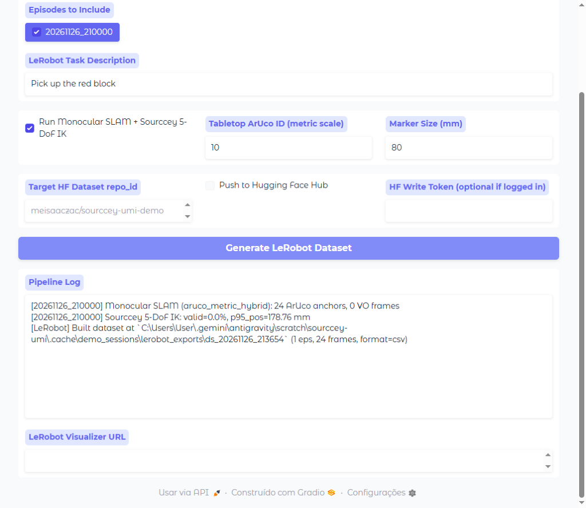

<div align="center">

# Sourccey UMI

**A handheld UMI gripper built around the real [Vulcan Robotics Sourccey](https://vulcanrobotics.ai) gripper.**

[](LICENSE)
[](https://github.com/meisaaczac/sourccey-umi/actions/workflows/ci.yml)
[](validation/RESULTS.md)
[](BOM.md)
[](https://github.com/vulcan-forge/sourccey-hardware)

<p>
  <a href="#how-it-works">How It Works</a> ·
  <a href="#demo-human-umi-to-sourccey-robot">Demo</a> ·
  <a href="docs/03-assembly.md">Assembly</a> ·
  <a href="BOM.md">BOM</a> ·
  <a href="docs/04-electronics-and-software.md">Software & Web App</a> ·
  <a href="validation/RESULTS.md">Validation</a>
</p>



</div>

> **Heads up:** this repo is **vibe coded** and still a work in progress. Maintenance, cleanup, real hardware tests, and more updates are still coming.

---

## Why build it this way?

Most handheld UMI grippers have a mismatch between what you hold in your hand and what is actually on the robot. Here we just use the Sourccey's own parts:

- **Same gripper:** bolts straight onto the real Sourccey base and hinged finger (`vulcan-forge/sourccey-hardware`).
- **Same servo as the encoder:** uses the Sourccey's Feetech STS3215 with torque turned off (0.088° resolution), so the angle you read is literally the robot's `gripper` joint (`-5°` closed to `60°` open).
- **Same wrist camera:** uses just the Sourccey's 20x20 mm camera sitting behind the Ø25 mm side wing, keeping the exact same view of the jaws.
- **Only two extra printed parts:** a pistol grip (bolts onto the 5-hole wrist face) and a trigger lever (bolts onto the 4-hole cross on the finger). Both LEFT and RIGHT files are included.
- **Web app + LeRobot export (`space/` & `policy/`):** a Gradio dashboard and Hugging Face Space inspired by [Pollen Robotics Grabette](https://github.com/pollen-robotics/grabette) to record sessions, run monocular SLAM + 5-DoF IK, apply latency matching + relative end-effector actions + automatic QC filtering, export a [LeRobot](https://github.com/huggingface/lerobot) dataset, open it in the [LeRobot Visualizer](https://huggingface.co/spaces/lerobot/visualize_dataset), and train ACT / Diffusion Policy.
- **Bimanual & Portable Wireless ready:** supports daisy-chained dual-arm recording (`software/record_bimanual.py`) and an optional Raspberry Pi Zero 2W + 2S LiPo + BNO085 IMU + grip pushbutton portable pack (`software/portable_node.py`).

---

## Demo: Human UMI to Sourccey Robot

Phase 1 shows a person picking and placing a block with the handheld Sourccey UMI. Phase 2 replays that same trajectory and STS3215 gripper opening (`q`) on the real Sourccey 5-DoF arm URDF. Check the top-right PiP to see the wrist camera view staying identical in both phases.



Full HD video (`1280x720`, 30 fps): [`docs/media/sourccey_umi_demo.mp4`](docs/media/sourccey_umi_demo.mp4). You can re-render it locally with `python docs/render_demo_video.py`.

---

## How It Works

<table>
  <tr>
    <td width="52%">
      
    </td>
    <td width="48%">
      <ol>
        <li><b>Pistol grip</b> bolts onto the rear 5-hole wrist interface of the Sourccey base using 5x M3 heat-set inserts.</li>
        <li><b>Trigger lever</b> bolts onto the 4-hole cross on the outer side of the Sourccey finger.</li>
        <li><b>Pulling the index trigger</b> closes the jaw (<code>q = 60°</code> down to <code>-5°</code>, ~47 mm travel). Releasing lets the return spring (and velcro finger strap) open it back to the 60° stop.</li>
        <li><b>STS3215 servo</b> (torque off, 7.4 V powered) logs angle at ~200 Hz on the same clock as the <b>20x20 mm Sourccey wrist camera</b>.</li>
      </ol>
    </td>
  </tr>
</table>


---

## Sourccey UMI Studio (Web App & HF Space)

A local Gradio dashboard and Hugging Face Space ([`space/`](space/README.md)) modeled after Pollen Robotics' `grabette-fleet` and `grabette-slam`, built for the single 20x20 mm camera + STS3215 setup.

<table>
  <tr>
    <td width="50%" align="center">
      
      <br><sub><b>Tab 1:</b> Create tasks, record from USB cam + STS3215, or import episode ZIPs</sub>
    </td>
    <td width="50%" align="center">
      
      <br><sub><b>Tab 2:</b> Run Monocular SLAM + 5-DoF IK, build LeRobot dataset, and open in Visualizer</sub>
    </td>
  </tr>
</table>

---

## Current Status

| Part | Status | Notes |
|---|---|---|
| **CAD vs real Sourccey STLs** | **17 / 17 pass** | Watertight meshes, clearances, camera ray-cast, hole alignment ([`validation/RESULTS.md`](validation/RESULTS.md)) |
| **Software & LeRobot bridge** | **Tests pass in sim** | Servo reader, recorder, ArUco sync, monocular SLAM, 5-DoF IK, Grabette & LeRobot export (`test_*.py`) |
| **Physical print & bench test** | **Not done yet** | Run through [`BENCH_CHECKLIST.md`](BENCH_CHECKLIST.md) before collecting real training data |
| **6-DoF pose tracking** | **Monocular SLAM included** | Uses the 20x20 mm camera + a printed tabletop ArUco marker for metric scale (`software/mono_slam.py`). Top 1/4-20 slot is optional if you ever want to add a depth camera later. |

---

## Quick Start

```bash
git clone https://github.com/meisaaczac/sourccey-umi && cd sourccey-umi
pip install -r requirements.txt

# 1. (Optional) Re-download and re-orient the Sourccey base & finger STLs from Vulcan Robotics
#    (print-ready LEFT and RIGHT STLs are already included in cad/stl/ and cad/stl_sourccey/)
python tools/prepare_sourccey_parts.py

# 2. (Optional) Regenerate the trigger lever and pistol grip (LEFT and RIGHT)
python cad/umi_cad.py

# 3. Run all software tests
make test

# 4. Launch the Sourccey UMI Studio web app (Record -> SLAM -> LeRobot -> Visualizer)
pip install -r space/requirements.txt
python space/app.py                      # http://localhost:7860
```

Docs in order:
1. **[Printing](docs/02-printing.md)** (PETG settings, orientation, LEFT/RIGHT parts)
2. **[Assembly](docs/03-assembly.md)** (9-step guide with checklists and troubleshooting)
3. **[Electronics & Software](docs/04-electronics-and-software.md)** (wiring, calibration, web app, Grabette & LeRobot)
4. **[Data Collection](docs/05-data-collection.md)** (tips for the 5-DoF Sourccey arm)
5. **[Bench Checklist](BENCH_CHECKLIST.md)** (physical checks before recording datasets)

---

## Specs

| Parameter | Value |
|---|---|
| **Printed weight** *(4 parts, PETG 40% infill)* | ~187 g *(plus ~55 g STS3215, camera, and screws)* |
| **Gripper range (`q`)** | `-5°` (closed) to `60°` (open stop) |
| **Angle resolution** | `0.088°` per step (STS3215 12-bit) |
| **Trigger travel** | ~47 mm over the full 65° sweep |
| **Return spring** | 28 mm (open) to 59 mm (closed) |
| **Jaw gap** *(at 55 mm depth)* | `10.6 mm` (`-5°`), `35 mm` (`20°`), `57 mm` (`40°`), `82 mm` (`55°`) |
| **Camera** | Single **Sourccey 20x20 mm** wrist camera in the `+y` wing (Ø25 mm hole) |
| **Optional top mount** | Standard 1/4-20 hex slot at `(-51, -7, 34) mm` in pivot frame |

---

## Repo Layout

```text
sourccey-umi/
├── BOM.md & bom/bom.csv       # Bill of materials (Markdown + CSV)
├── BENCH_CHECKLIST.md         # Physical tests to run before real data collection
├── cad/                       # Parametric CadQuery source + all print-ready STLs (stl/, stl_sourccey/) & STEPs
├── docs/                      # Guides, studio renders, MuJoCo demo video & GIF
├── software/                  # STS3215 reader, single & bimanual recorder, portable Pi node, mono SLAM, 5-DoF IK, LeRobot bridge
├── policy/                    # Ready-to-run LeRobot ACT / Diffusion Policy training launcher & guide
├── space/                     # Sourccey UMI Studio (local web UI + Hugging Face Docker Space)
├── tools/                     # Re-downloads & orients Sourccey STLs from Vulcan Robotics upstream
└── validation/                # 17 automated geometric, mechanical, and software checks
```

---

## Things to Keep in Mind

- **5-DoF arm limits:** the Sourccey arm has 5 joints + gripper, so not every 6-DoF hand pose is reachable. `software/build_episode.py` reports position/orientation IK error per frame and flags bad frames automatically.
- **Unpowered servo friction:** an unpowered STS3215 has some gearbox drag, so keep the velcro strap on the trigger pad until bench tests 4 and 5 pass.
- **Pollen `grabette-slam` cloud Space:** Pollen's official `grabette-slam` Space uses RTAB-Map RGB-D SLAM and expects depth frames. Since this UMI uses a single 20x20 mm RGB camera, use our included [`space/`](space/README.md) app (`software/mono_slam.py` + `software/grabette_lerobot.py`) instead.

---

## Authors & License

Made by **Isaac de Souza** ([@meisaaczac](https://github.com/meisaaczac)) with AI assistance (vibe coded, actively evolving).
Code, CAD, and docs are under the **MIT License** ([`LICENSE`](LICENSE)). Original Sourccey gripper meshes in `cad/stl_sourccey/` belong to Vulcan Robotics (see [`NOTICE.md`](NOTICE.md) and [`AUTHORS.md`](AUTHORS.md)).
