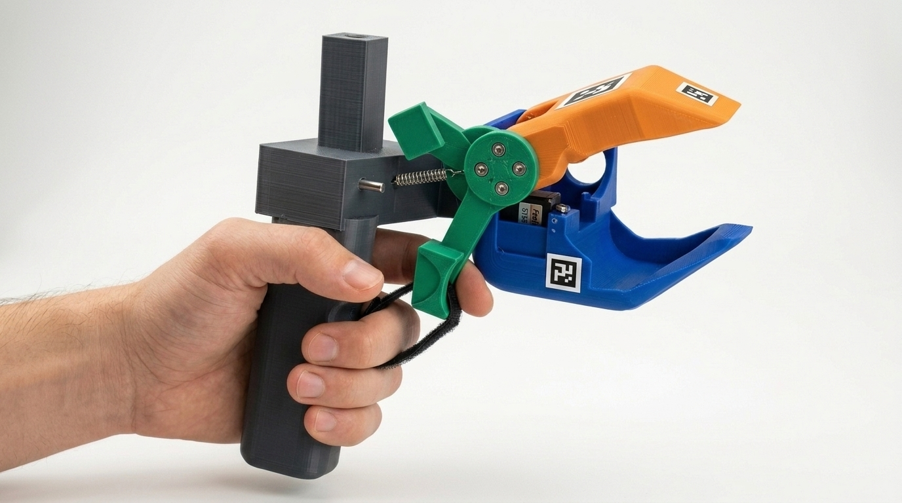

<div align="center">

# Sourccey UMI

**A handheld Universal Manipulation Interface built around the real [Vulcan Robotics Sourccey](https://vulcanrobotics.ai) gripper.**

[](LICENSE)
[](validation/RESULTS.md)
[](BOM.md)
[](https://github.com/vulcan-forge/sourccey-hardware)

<p>
  <a href="#how-it-works">How It Works</a> ·
  <a href="#demo-human-umi--sourccey-robot">Demo Video</a> ·
  <a href="docs/03-assembly.md">Assembly Guide</a> ·
  <a href="BOM.md">Bill of Materials</a> ·
  <a href="docs/04-electronics-and-software.md">Software & IK</a> ·
  <a href="validation/RESULTS.md">Validation</a>
</p>


</div>

---

## Why Sourccey UMI?

Most handheld UMI grippers suffer from an **embodiment gap**: the handheld jaws, compliance, and camera viewpoint differ from the target robot. **Sourccey UMI eliminates that gap by using the Sourccey's actual gripper:**

- **Same gripper hardware** — Bolts directly onto the real Sourccey base and hinged finger (`vulcan-forge/sourccey-hardware`).
- **Same servo encoder** — Uses the Sourccey's own Feetech STS3215 (torque off, read-only) at **0.088° resolution**, so the measured angle *is* the robot's `gripper` joint (`-5°` closed to `60°` open).
- **Same wrist-camera viewpoint** — Houses the Sourccey's 20 × 20 mm camera behind the base's Ø25 mm side wing with zero occlusion of the jaw gap (ray-cast verified).
- **Two printable add-ons only** — Just a parametric **pistol grip** (5-hole wrist interface + 1/4-20 tracker pedestal) and a **trigger lever** (4-hole finger cross + return spring + velcro strap). Both LEFT and RIGHT arm variants included.

---

## Demo: Human UMI → Sourccey Robot

A human demonstrates a tabletop pick-and-place with the handheld Sourccey UMI (Phase 1); the recorded 6-DoF trajectory and STS3215 gripper opening (`q`) are retargeted via 5-DoF IK onto the real Sourccey arm URDF (Phase 2). Notice the **identical wrist-camera viewpoint** in the top-right PiP.


> **Full HD render (1280×720, 30 fps):** [`docs/media/sourccey_umi_demo.mp4`](docs/media/sourccey_umi_demo.mp4) · Regenerate locally with `python docs/render_demo_video.py`.

---

## How It Works

<table>
  <tr>
    <td width="52%">
      
    </td>
    <td width="48%">
      <ol>
        <li><b>Pistol grip</b> bolts onto the Sourccey base through the exact 5-hole wrist interface (with 5× M3 heat-set inserts).</li>
        <li><b>Trigger lever</b> bolts onto the 4-hole cross on the outer face of the Sourccey finger.</li>
        <li><b>Pulling the index trigger</b> closes the hinged finger (<code>q = 60° → -5°</code>, ~47 mm pad travel); releasing lets the extension spring (plus velcro finger strap) reopen it cleanly to the 60° mechanical stop.</li>
        <li><b>STS3215 servo</b> (torque off, 7.4 V powered) streams angle at ~200 Hz while the <b>20 × 20 mm wrist camera</b> and top <b>1/4-20 pose tracker</b> record synchronized video and 6-DoF hand pose.</li>
      </ol>
    </td>
  </tr>
</table>


---

## Project Status

> [!NOTE]
> Transparent engineering status — read before printing or collecting datasets.

| Subsystem | Status | Details |
|---|---|---|
| **CAD vs. real Sourccey STLs** | **17 / 17 checks pass** | Watertight meshes, clearances, camera ray-cast, hole alignment ([`validation/RESULTS.md`](validation/RESULTS.md)) |
| **Software pipeline** | **Simulated tests pass** | Servo reader, recorder, ArUco sync, 5-DoF IK (`test_software.py`, `test_pipeline.py`) |
| **Physical print & bench test** | **Not yet validated** | Complete [`BENCH_CHECKLIST.md`](BENCH_CHECKLIST.md) before training data collection |
| **6-DoF Pose Tracker / SLAM** | **Mount included only** | 1/4-20 pedestal provided; pair with GoPro + UMI SLAM, Quest (HandUMI), or [Grabette](https://github.com/pollen-robotics/grabette) |

---

## Quick Start

```bash
git clone https://github.com/meisaaczac/sourccey-umi && cd sourccey-umi
pip install -r requirements.txt

# 1. Download & orient the REAL Sourccey base and finger STLs from Vulcan Robotics
python tools/prepare_sourccey_parts.py

# 2. (Optional) Regenerate parametric trigger lever & pistol grip (LEFT & RIGHT)
python cad/umi_cad.py

# 3. Run all 17 automated CAD & software validations
python validation/run_all.py
```

Then follow the build & setup workflow:
1. **[Printing Guide](docs/02-printing.md)** — PETG settings, orientation, and LEFT/RIGHT files
2. **[Illustrated Assembly Guide](docs/03-assembly.md)** — 9-step build with checklists, exploded view, and troubleshooting
3. **[Electronics & Software](docs/04-electronics-and-software.md)** — STS3215 wiring, calibration, recording, ArUco sync, and IK
4. **[Data Collection Protocol](docs/05-data-collection.md)** — Best practices for the 5-DoF Sourccey arm
5. **[Bench Checklist](BENCH_CHECKLIST.md)** — Physical verification gates before dataset recording

---

## Key Specifications

| Parameter | Value |
|---|---|
| **Printed mass** *(4 parts, PETG 40% infill)* | ~187 g *(+ ~55 g STS3215 servo, camera & fasteners)* |
| **Joint range (`q`)** | `-5°` (closed) to `60°` (open stop) |
| **Angle resolution** | `0.088°` per encoder tick (STS3215 12-bit) |
| **Trigger pad travel** | ~47 mm over full 65° sweep |
| **Return spring travel** | 28 mm (open) → 59 mm (closed) |
| **Jaw gap** *(at 55 mm grasp depth)* | `10.6 mm` (`-5°`) · `35 mm` (`20°`) · `57 mm` (`40°`) · `82 mm` (`55°`) |
| **Pose tracker mount** | Standard 1/4-20 hex bolt at `(-51, -7, 34) mm` in pivot frame |

---

## Repository Structure

```text
sourccey-umi/
├── BOM.md & bom/bom.csv       # Complete bill of materials (Markdown + CSV)
├── BENCH_CHECKLIST.md         # Physical bench validation tests & pass criteria
├── cad/
│   ├── umi_cad.py             # Parametric CadQuery source for grip & trigger lever
│   ├── stl/                   # Print-ready STLs (LEFT and RIGHT variants)
│   └── step/                  # Editable STEP assemblies
├── docs/
│   ├── 01-how-it-works.md     # Mechanical design & kinematics
│   ├── 02-printing.md         # Slicer settings & part preparation
│   ├── 03-assembly.md         # Illustrated 9-step assembly manual
│   ├── 04-electronics-and-software.md
│   ├── 05-data-collection.md
│   ├── 06-validation.md
│   ├── 07-research-and-decisions.md
│   ├── img/                   # Studio renders & CAD step diagrams
│   ├── media/                 # MuJoCo UMI -> Sourccey robot demo video & GIF
│   ├── make_images.py         # Rebuilds CAD step diagrams
│   └── render_demo_video.py   # Rebuilds MuJoCo pick-and-place video & GIF
├── software/                  # STS3215 reader, recorder, ArUco sync, 5-DoF IK, tests
├── tools/                     # Downloads real Vulcan Sourccey STLs (not redistributed)
└── validation/                # 17 automated geometric/mechanical/software checks
```

---

## Important Limitations

- **5-DoF arm kinematics:** The Sourccey arm has 5 arm joints + gripper, so not every 6-DoF hand pose is reachable. `software/build_episode.py` reports per-frame position/orientation IK errors and filters invalid frames automatically.
- **Unpowered servo friction:** STS3215 gearbox drag can oppose the return spring; keep the **velcro index-finger strap** installed until bench tests 4 & 5 pass.
- **SLAM & dataset export:** This repo does not bundle SLAM or LeRobot export—pair it with [Grabette](https://github.com/pollen-robotics/grabette) (Apache-2.0) or the upstream UMI SLAM pipeline.

---

## Authors & License

Created by **Isaac de Souza** ([@meisaaczac](https://github.com/meisaaczac)) with AI engineering assistance.
Code, CAD, and documentation are released under the **MIT License** ([`LICENSE`](LICENSE)). Real Vulcan Robotics / Sourccey hardware meshes are downloaded directly from upstream and are **not** redistributed here—see [`NOTICE.md`](NOTICE.md) and [`AUTHORS.md`](AUTHORS.md).
