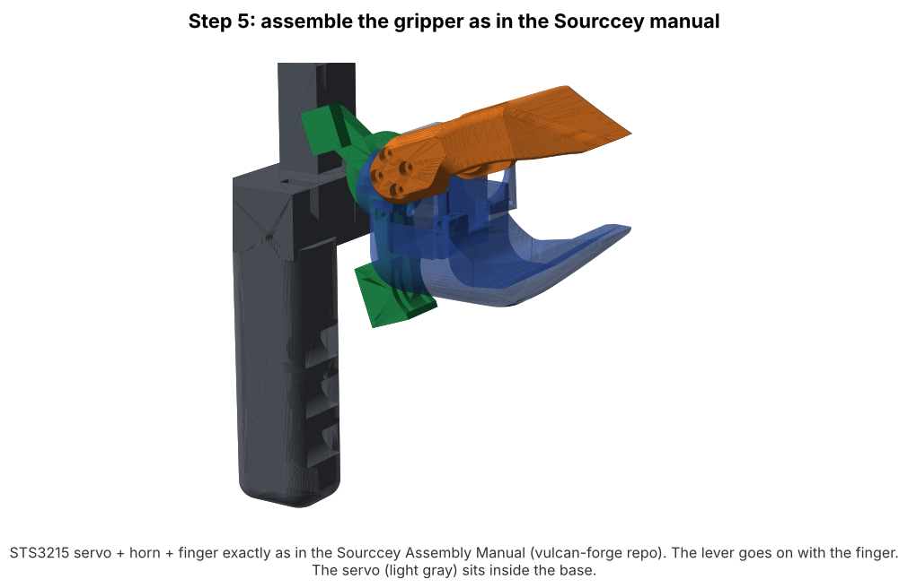

# How it works

## The idea
A UMI is a handheld gripper that records video + gripper opening + pose, so you can train a robot without using the robot. The classic problem is the mismatch between the handheld gripper and the robot's. Here the gripper **is** the robot's: same base, same finger, same servo. The angle the servo measures is the Sourccey `gripper` joint (URDF: -5° closed, 60° open).

## Mechanics
- The Sourccey's **hinged finger** rotates around the servo pivot; the lower jaw is fixed to the base.
- **Trigger lever** (green): a 6 mm plate bolted to the outer face of the finger's -y side, using the 4-hole cross the real finger already has. It hangs down outside the base and ends in the concave **index pad**.
- **Pistol trigger**: the index finger sits in front of the pad and pulls back: the gripper **closes**. Pad travel: ~47 mm for the full 65°.
- **Extension spring** from an anchor in the grip beam to the lever tail: it always pushes **open** (verified over the whole travel). A **velcro strap** on the pad lets the index finger also push open.
- **Open stop**: the tail tab rests on top of the beam at 59 to 60°, the robot's limit.
- **Pistol grip** on the trigger side (the side opposite the robot's camera), attached to the base through the same 5-hole interface that holds the wrist on the Sourccey.

## Sensor
The Sourccey's STS3215 servo, torque off, returns the position (0 to 4095 = 360°). `software/sts_angle.py` calibrates (it finds the direction by itself) and converts to the robot's joint.

## Camera
The base's side wing has a Ø25 mm opening aimed at the jaws. The Sourccey's 20x20 camera sits behind it, with the same viewpoint as the robot. My parts do not block that view (checked by ray casting).

## Numbers
| | |
|---|---|
| Printed mass (estimate) | ~180 g |
| Angle resolution | 0.088° |
| Trigger travel | ~47 mm |
| Spring | 59 mm (closed) to 27 mm (open) |
| Jaw gap at 55 mm from the pivot | 10.6 mm (q=-5°), 35 mm (q=20°), 57 mm (q=40°), 82 mm (q=55°). Full table in `software/sourccey_gripper_joint_vs_width.csv` (the gripper is hinged: the gap changes with grasp depth) |
