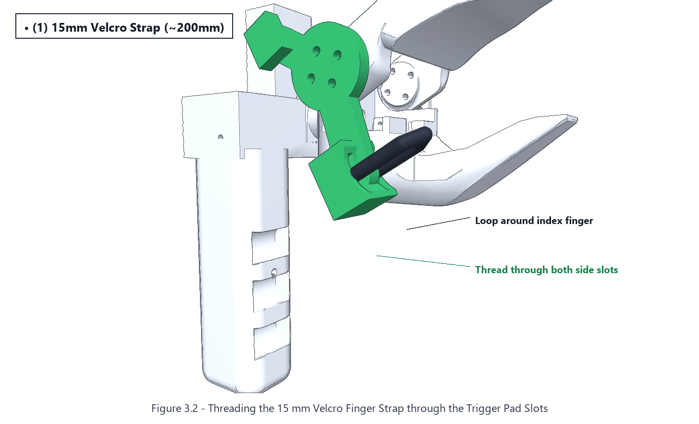
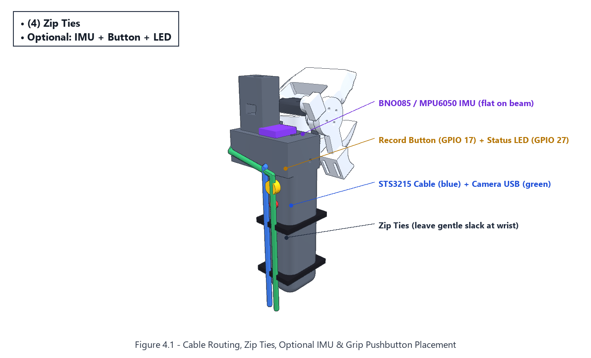
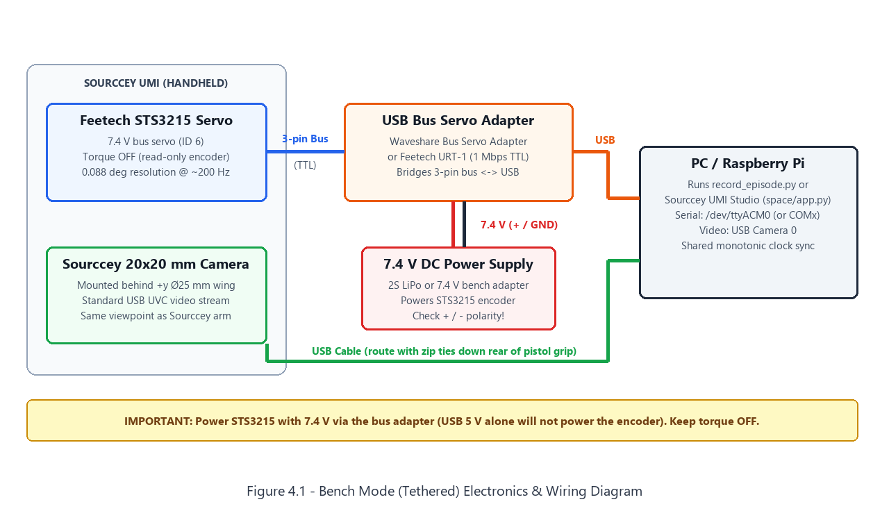
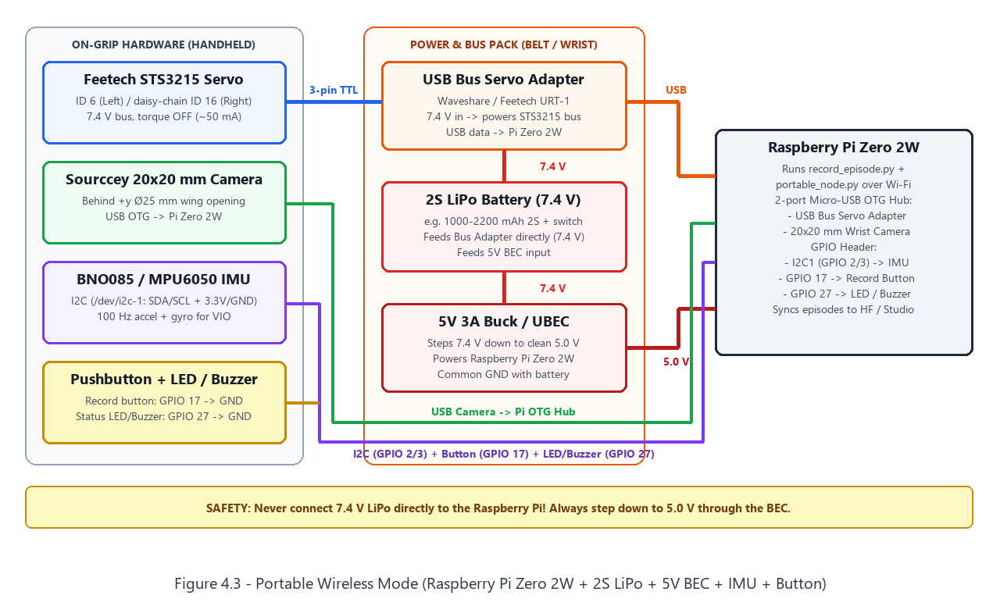
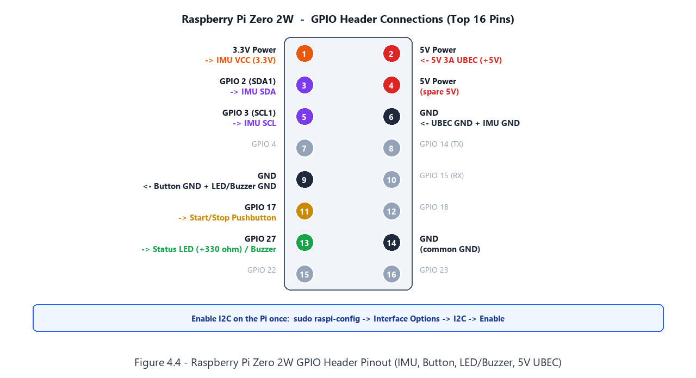
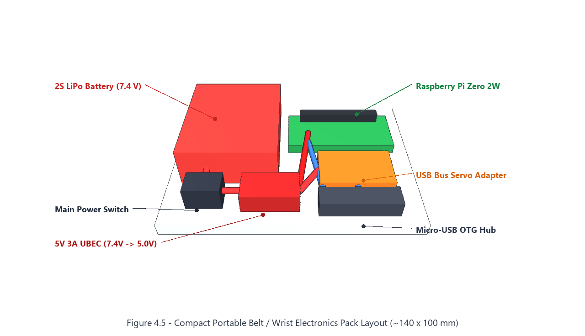
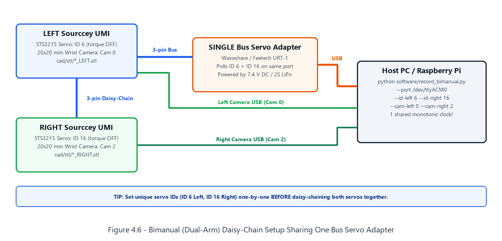
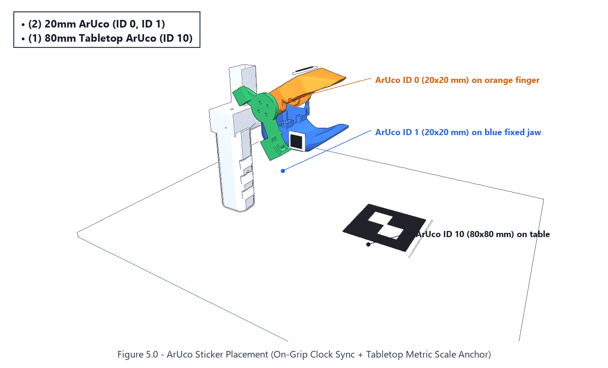

# Sourccey UMI Assembly Manual

Complete, step-by-step illustrated build manual structured in the same stage-by-stage style as the official Vulcan Robotics *Sourccey Assembly Manual*. Covers the full mechanical build, STS3215 servo installation, return spring and velcro strap, 20x20 mm wrist camera, cable routing, **Bench Mode (tethered)**, **Portable Wireless Mode (Raspberry Pi Zero 2W + 2S LiPo + IMU + button)**, **Bimanual (Dual-Arm)** daisy-chaining, ArUco placement, and first power-on checks.


---

## Stage 0: Preparation, Tools & Build Modes

| Build Mode | Time *(excl. printing)* | What You Need Beyond Core Parts | Best For |
|---|---|---|---|
| **Mode A: Bench (Tethered)** | ~45 min | PC/laptop + USB Bus Adapter + 7.4 V PSU | Fastest, cheapest first build |
| **Mode B: Portable Wireless** | ~75 min | Raspberry Pi Zero 2W + 2S LiPo + 5V 3A UBEC + OTG Hub + IMU + Button/LED | Walking around collecting data with no tether |
| **Dual-Arm (Bimanual)** | +40 min | Second UMI (`_RIGHT` STLs + STS3215 `ID 16` + 2nd 20x20 mm camera) | Folding laundry and two-handed tasks |

### Tools Checklist
- [ ] Soldering iron with conical or heat-set tip (~220 °C for PETG)
- [ ] Hex keys (2.0 mm / 2.5 mm for M3 pan/socket-head screws)
- [ ] Small Phillips screwdriver (for STS3215 servo horn and mounting screws)
- [ ] Needle-nose pliers (for hooking the extension spring)
- [ ] Scissors (for trimming the 15 mm velcro strap)
- [ ] Multimeter *(strongly recommended for Mode B: verify 5.0 V on UBEC output before plugging in the Pi)*
- [ ] Flush cutters / deburring tool (for cleaning print brims and supports)

---

## Stage 1: Printed Parts & Pistol Grip Sub-Assembly

### Materials
| Type | Name | Count |
|---|---|---|
| Part | Sourccey Base (`cad/stl_sourccey/base_sourccey_gripper_LEFT.stl`) | 1 |
| Part | Sourccey Finger (`cad/stl_sourccey/finger_sourccey_gripper_LEFT.stl`) | 1 |
| Part | Pistol Grip (`cad/stl/pistol_grip_LEFT.stl`) | 1 |
| Part | Trigger Lever (`cad/stl/trigger_lever_LEFT.stl`) | 1 |
| Fastener | M3 Heat-Set Insert (for Ø4.2 mm holes, 6 mm deep) | 5 |
| Fastener | M3x20mm Screw (pan head) | 5 |

*(For the right hand, use the `*_RIGHT.stl` files. Print in PETG: 0.2 mm layers, 4 perimeters, 40% infill; see [`02-printing.md`](02-printing.md).)*

### Procedure
1. Print and clean all 4 parts as shown in **Figure 1.0**.
   - a. Remove any support material from inside the 5 counterbores on the Sourccey Base and the spring channel inside the Pistol Grip beam.
   - b. Dry-fit a spare M3 screw through all 4 holes in the Trigger Lever and all 5 holes in the Sourccey Base before heating up the iron.
2. Press the 5 brass M3 heat-set inserts flush into the 5-hole cross on the Pistol Grip (~220 °C) as shown in **Figure 1.1**.
   - a. `(5) M3 Heat-Set Insert`
   - b. Press straight down with gentle pressure until completely flush; let the PETG cool for 2 minutes. If an insert tilts, reheat and square it up right away.
3. Fasten the Pistol Grip to the Sourccey Base from **inside** the base counterbores as shown in **Figure 1.2**.
   - a. `(5) M3x20mm` tightened evenly in a cross pattern.
   - b. **Do this before installing the STS3215 servo**, otherwise the servo blocks hex-key access to the inner screws.
   - c. *Check:* Twist the grip firmly against the base. There must be zero play or flex.


---

## Stage 2: Trigger Lever, STS3215 Servo & Finger Assembly

### Materials
| Type | Name | Count |
|---|---|---|
| Sub-Assembly | Pistol Grip + Sourccey Base (from Stage 1) | 1 |
| Part | Sourccey Finger | 1 |
| Part | Trigger Lever | 1 |
| Electronics | Feetech STS3215 7.4 V Servo + Horn + Servo Screws (prefer 1:147 or 1:191 ratio) | 1 |
| Fastener | M3x16mm Screw (pan head) | 4 |

### Procedure
1. Fasten the Trigger Lever flat onto the `-y` outer face of the Sourccey Finger (4-hole cross, opposite the camera wing) as shown in **Figure 2.1**.
   - a. `(4) M3x16mm` *(if screws are already installed on that side of your finger, swap them for ones 6 mm longer to cover the 6 mm lever plate)*
   - b. *Check:* Twist the lever against the finger by hand. They must move as one rigid piece.
2. **Pre-configure the STS3215 Servo ID (recommended before mounting):**
   - a. If building a single UMI, set the servo ID to `6` (default in this repo). If building a bimanual pair, set Left to `6` and Right to `16` one at a time before daisy-chaining.
   - b. Plug the 3-pin TTL bus cable into the rear port of the STS3215 now if access is tight once seated.
3. Slide the **Feetech STS3215 servo** straight down into the central cavity of the Sourccey Base and secure it with its mounting screws as shown in **Figure 2.2**.
   - a. `(1) Feetech STS3215 7.4V`
   - b. Make sure the servo stays **unpowered (torque OFF)** during mechanical assembly.
4. Install the servo horn and mount the Finger + Trigger Lever sub-assembly onto the STS3215 output spline as shown in **Figure 2.3** (matching the official *Sourccey Assembly Manual*).
   - a. *Check:* Turn the finger by hand through its full sweep from `-5°` (closed on fixed jaw) to `60°` (open). Verify zero rubbing against the base or grip, and confirm the lever's rear tail tab lands cleanly on top of the grip beam at `~58 to 60°`.


---

## Stage 3: Anchor Pin, Return Spring, Velcro Strap & Wrist Camera

### Materials
| Type | Name | Count |
|---|---|---|
| Fastener | M3x70mm Screw + M3 Nut *(or 3 mm smooth rod)* | 1 |
| Hardware | Extension Spring (~15 mm free length, ~0.15 N/mm, extends to ~59 mm) | 1 |
| Hardware | 15 mm Velcro Strap (~200 mm long) | 1 |
| Electronics | Sourccey 20x20 mm USB Wrist Camera + Robot Camera Mount | 1 |

### Procedure
1. Install the anchor pin and return spring as shown in **Figure 3.1**:
   - a. Slide the `(1) M3x70mm` screw through the transverse hole in the grip beam (`x = -42 mm, z = -26 mm`), capturing one hook of the `(1) Extension Spring` inside the center slot as it passes through.
   - b. Thread the `M3 Nut` onto the far end (snug, do not crush the printed walls).
   - c. Use needle-nose pliers to hook the other end of the spring into the Ø3.2 mm hole in the upper tail of the green Trigger Lever.
   - d. *Check:* The spring should be short when open (`~28 mm` at `q = 60°`) and stretched when closed (`~59 mm` at `q = -5°`), always pulling the jaws open.
2. Thread the `(1) 15 mm Velcro Strap` through both vertical side slots on the concave green trigger pad as shown in **Figure 3.2**.
   - a. Close the velcro loop comfortably around your index finger so you can both pull to close and assist pushing open if unpowered servo friction is high.
3. Mount the `(1) Sourccey 20x20 mm Wrist Camera` behind the Ø25 mm circular opening in the `+y` side wing of the blue base using your robot's camera mount, as shown in **Figure 3.3**.
   - a. Aim the lens straight toward the jaw tips and double-check that the board sits centered behind the Ø25 mm hole.





---

## Stage 4: Cable Routing, Electronics & Power

Choose **Mode A (Bench / Tethered)** for desktop recording, or **Mode B (Portable Wireless)** to walk around untethered with a Raspberry Pi Zero 2W + 2S LiPo battery + IMU + grip pushbutton.

### Step 4.1: Cable Routing, Zip Ties & On-Grip Sensors (Both Modes)
Route all cables cleanly along the back of the pistol grip as shown in **Figure 4.1**:
1. Guide the **3-pin STS3215 servo cable (blue)** out of the rear of the base cavity and straight down the back of the pistol grip.
2. Guide the **20x20 mm wrist camera USB cable (green)** from the `+y` side wing cleanly around the back of the base and down alongside the servo cable.
3. *(Mode B Portable only)* Stick the **BNO085 or MPU6050 IMU** flat on top of the grip beam (double-sided VHB tape), and mount the **Start/Stop pushbutton** + **Status LED / piezo buzzer** on the upper rear of the grip where your thumb can tap it without shifting your hold.
4. Secure the cable bundle with `(4) Zip Ties` around the grip (leaving a gentle service loop below the grip so wrist rotation never tugs on the servo or camera connectors).



---

### Mode A: Bench / Tethered Wiring (Simplest & Lowest Cost)

#### Materials (Mode A)
| Type | Name | Count |
|---|---|---|
| Electronics | Feetech / Waveshare USB Bus Servo Adapter (e.g. URT-1) | 1 |
| Electronics | 7.4 V DC Power Supply (7.4 V 2A wall adapter or 2S LiPo) | 1 |
| Cable | 3-Pin Feetech TTL Servo Bus Cable | 1 |
| Cable | USB Data Cable (Adapter -> PC) + Camera USB Cable (Camera -> PC) | 2 |

#### Procedure (Mode A)
1. Wire everything as shown in **Figure 4.2**:
   - a. Connect the **3-pin TTL bus cable** from the STS3215 servo to the **USB Bus Servo Adapter**.
   - b. Connect the **7.4 V DC power supply** to the adapter's power screw terminals (verify `+` and `GND` polarity!). *USB 5 V alone will NOT power the STS3215 encoder.*
   - c. Plug both the **USB Bus Servo Adapter** and the **Sourccey 20x20 mm Camera** into your PC or laptop.
2. Verify the serial port shows up (`/dev/ttyACM0` on Linux, `COMx` on Windows) and the wrist camera opens in a preview window.



---

### Mode B: Portable Wireless Pack (Raspberry Pi Zero 2W + 2S LiPo + IMU + Button)

#### Additional Materials (Mode B)
| Type | Name | Count |
|---|---|---|
| Electronics | Raspberry Pi Zero 2W + 32 GB microSD card (Raspberry Pi OS Lite 64-bit) | 1 |
| Electronics | 2S LiPo Battery (7.4 V, 1000 to 2200 mAh) + XT30/JST inline power switch | 1 |
| Electronics | 5 V 3A Buck Converter / UBEC (steps 7.4 V down to regulated 5.0 V) | 1 |
| Electronics | 2-Port Micro-USB OTG Hub (connects Bus Adapter + 20x20 mm Camera to Pi) | 1 |
| Electronics | BNO085 or MPU6050 IMU breakout (3.3 V I2C) | 1 |
| Hardware | Momentary Tactile Pushbutton + Status LED (with 330 ohm resistor) or 3.3 V Piezo Buzzer | 1+1 |

#### Procedure (Mode B)
1. **Power rail assembly (check with a multimeter first!):** wire the power pack as shown in **Figure 4.3** and **Figure 4.5**:
   - a. Connect the **2S LiPo (7.4 V)** through the **Main Power Switch** to BOTH the **USB Bus Servo Adapter (`7.4 V` in)** and the **5 V 3A UBEC input**.
   - b. Turn on the switch and measure the UBEC output with a multimeter: confirm it reads **`5.0 V +/- 0.1 V`** before connecting the Raspberry Pi.
   - c. Turn the switch OFF, then connect the **5.0 V UBEC output** to the Raspberry Pi Zero 2W (`Pin 2 -> +5V`, `Pin 6 -> GND`). **Never connect 7.4 V directly to the Pi.**
2. **GPIO wiring (IMU, Pushbutton, Status LED/Buzzer):** wire the top 16 pins of the Raspberry Pi 40-pin header exactly as shown in **Figure 4.4**:
   - a. **IMU (I2C1):** `Pin 1 (3.3V) -> VCC`, `Pin 6 (GND) -> GND`, `Pin 3 (GPIO 2 / SDA) -> SDA`, `Pin 5 (GPIO 3 / SCL) -> SCL`.
   - b. **Start/Stop Pushbutton:** `Pin 11 (GPIO 17) -> Button Terminal 1`, `Pin 9 (GND) -> Button Terminal 2`.
   - c. **Status LED / Buzzer:** `Pin 13 (GPIO 27) -> (+ 330 ohm resistor if LED) -> LED/Buzzer (+)`, `Pin 9 or 14 (GND) -> LED/Buzzer (-)`.
3. **USB OTG connections:** plug the **Micro-USB OTG Hub** into the Pi Zero 2W's **DATA** Micro-USB port, then plug both the **USB Bus Servo Adapter** and the **20x20 mm Wrist Camera** into the hub.
4. **Pack everything neatly** into a small ~140 x 100 mm belt pouch or wrist strap pouch as shown in **Figure 4.5**, keeping the LiPo battery padded and the main power switch accessible on the outside.
5. **First boot on the Pi Zero 2W:** enable I2C (`sudo raspi-config -> Interface Options -> I2C -> Enable`), verify the IMU shows up with `i2cdetect -y 1`, and test the portable daemon:
   ```bash
   python software/portable_node.py --imu bno085
   ```







---

### Optional: Bimanual (Dual-Arm) Daisy-Chain Setup

To collect two-handed demonstrations for both Sourccey arms simultaneously, wire both UMIs as shown in **Figure 4.6**:
1. Set unique servo IDs **one servo at a time** before connecting them together: **Left UMI = `ID 6`**, **Right UMI = `ID 16`**.
2. Plug a 3-pin TTL bus cable from the Right UMI's STS3215 into the spare 3-pin daisy-chain port on the Left UMI's STS3215, then connect the Left UMI to your **single USB Bus Servo Adapter**.
3. Plug both 20x20 mm USB wrist cameras into your PC (or powered USB hub) and record with:
   ```bash
   python software/record_bimanual.py --out ep_bi001 --port /dev/ttyACM0 --id-left 6 --id-right 16 --cam-left 0 --cam-right 2
   ```



---

## Stage 5: ArUco Stickers, Ergonomics & First Power-On Verification

### Materials
| Type | Name | Count |
|---|---|---|
| Hardware | Printed 20x20 mm ArUco Marker `ID 0` (`software/aruco_id0_20mm_300dpi.png`) | 1 |
| Hardware | Printed 20x20 mm ArUco Marker `ID 1` (`software/aruco_id1_20mm_300dpi.png`) | 1 |
| Hardware | Printed 80x80 mm Tabletop ArUco Marker `ID 10` (`DICT_4X4_50`, for monocular SLAM scale) | 1 |

### Procedure
1. Place all 3 ArUco markers cleanly as shown in **Figure 5.0**:
   - a. **`ID 0` (20x20 mm):** flat upper surface of the orange moving finger.
   - b. **`ID 1` (20x20 mm):** outer face of the blue fixed jaw.
   - c. **`ID 10` (80x80 mm):** taped flat on your workspace table in view of the wrist camera during demonstrations (gives `software/mono_slam.py` real metric scale in meters).
2. Hold the UMI naturally as shown in **Figure 5.1**: palm behind the grip, 3 fingers in the grip grooves, index finger inside the velcro loop on the green trigger pad.
3. Power on the 7.4 V supply, calibrate the STS3215 encoder, and verify the full sweep shown in **Figure 5.2**:
   ```bash
   python software/sts_angle.py calibrate --port /dev/ttyACM0 --id 6
   python space/app.py
   ```
   - a. **Released (Open Stop):** `q ~ 60°` (~82 mm jaw gap at 55 mm depth)
   - b. **Halfway:** `q ~ 30°` (~46 mm jaw gap)
   - c. **Fully Pulled (Closed):** `q ~ -5°` (~10.6 mm jaw gap)
4. Complete every test in [`BENCH_CHECKLIST.md`](../BENCH_CHECKLIST.md) before collecting real training datasets.




---

## Troubleshooting

| Symptom | Likely Cause | Fix |
|---|---|---|
| STS3215 does not respond on serial port | Powered only by 5 V USB, wrong ID, or swapped baud | Verify 7.4 V is present on the bus adapter terminals, confirm servo ID (`6` left / `16` right) and 1 Mbps baud. |
| Trigger feels heavy or won't return to `60°` | Unpowered servo gearbox friction | Keep the 15 mm velcro strap snug around your index finger, use a 1:147/1:191 STS3215, or step up to a ~0.20 N/mm spring. |
| Pi Zero 2W reboots when camera starts | Weak 5 V regulator or thin power wires | Use a dedicated 5 V 3A UBEC with short 20 AWG wires from the 2S LiPo. |
| `i2cdetect -y 1` shows no IMU | I2C disabled or SDA/SCL swapped | Run `sudo raspi-config` to enable I2C; check `Pin 3 (SDA)` and `Pin 5 (SCL)` plus `Pin 1 (3.3V)`. |
| `mono_slam.py` reports 0 ArUco anchors | Tabletop marker ID/size mismatch or glare | Use `DICT_4X4_50` ID 10 printed matte at 80x80 mm and keep it visible in the wrist camera view. |
