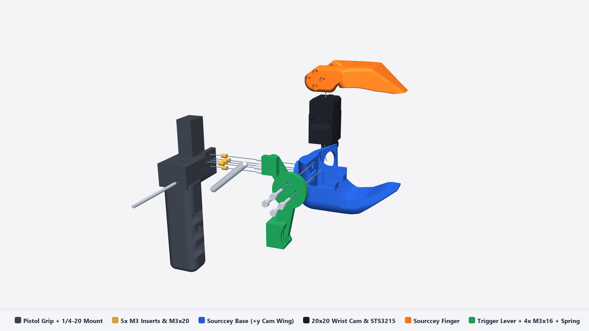
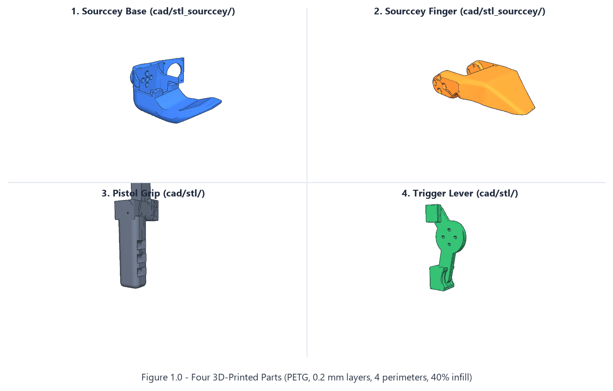
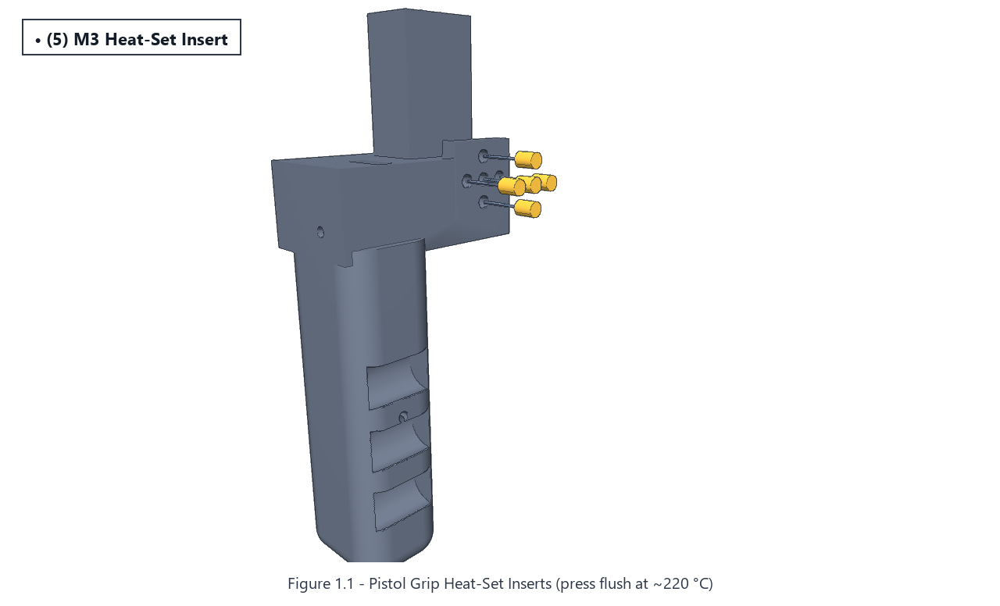

# Sourccey UMI Assembly Manual

Structured in the same stage-by-stage style as the official Vulcan Robotics *Sourccey Assembly Manual*.
Tools needed: soldering iron (~220 °C), M3 hex keys, needle-nose pliers, scissors. Time: ~45 to 60 min (excluding printing).

---

## Stage 1: Printed Parts & Pistol Grip Sub-Assembly

### Materials
| Type | Name | Count |
|---|---|---|
| Part | Sourccey Base (`cad/stl_sourccey/base_sourccey_gripper_LEFT.stl`) | 1 |
| Part | Sourccey Finger (`cad/stl_sourccey/finger_sourccey_gripper_LEFT.stl`) | 1 |
| Part | Pistol Grip (`cad/stl/pistol_grip_LEFT.stl`) | 1 |
| Part | Trigger Lever (`cad/stl/trigger_lever_LEFT.stl`) | 1 |
| Fastener | M3 Heat-Set Insert (Ø4.2 mm hole) | 5 |
| Fastener | M3x20mm Screw (pan head) | 5 |

*(For the right arm, use the `*_RIGHT.stl` files. Print settings: PETG, 0.2 mm layers, 4 perimeters, 40% infill; see [`02-printing.md`](02-printing.md).)*

### Procedure
1. Print and clean all 4 parts as shown in **Figure 1.0**.
2. Press the M3 heat-set inserts flush into the 5-hole cross on the Pistol Grip (~220 °C) as shown in **Figure 1.1**.
   - a. `(5) M3 Heat-Set Insert`
3. Fasten the Pistol Grip to the Sourccey Base from **inside** the base counterbores as shown in **Figure 1.2**.
   - a. `(5) M3x20mm`
   - b. **Do this before installing the STS3215 servo**, otherwise the servo blocks hex-key access. Check that the grip has zero twist play.

---

## Stage 2: Trigger Lever, Servo & Finger Assembly

### Materials
| Type | Name | Count |
|---|---|---|
| Sub-Assembly | Grip + Sourccey Base (from Stage 1) | 1 |
| Part | Sourccey Finger | 1 |
| Part | Trigger Lever | 1 |
| Electronics | Feetech STS3215 7.4 V Servo + Horn (1:147 or 1:191 gear ratio) | 1 |
| Fastener | M3x16mm Screw (pan head) | 4 |

### Procedure
1. Fasten the Trigger Lever flat onto the `-y` outer face of the Sourccey Finger (4-hole cross) as shown in **Figure 2.1**.
   - a. `(4) M3x16mm` *(if screws are already installed on that side, replace them with screws 6 mm longer)*
   - b. Check that the lever and finger move as one solid piece with no play.
2. Install the STS3215 servo, horn, and Finger + Lever sub-assembly into the Sourccey Base as shown in **Figure 2.2** (following the official *Sourccey Assembly Manual*).
   - a. Keep the servo **unpowered (torque off)**.
   - b. Sweep the finger by hand from `-5°` (closed) to `60°` (open): verify zero rubbing and confirm the lever's tail tab hits the open stop at `~58 to 60°`.

---

## Stage 3: Return Spring, Velcro Strap & Wrist Camera

### Materials
| Type | Name | Count |
|---|---|---|
| Fastener | M3x70mm Screw + M3 Nut *(or 3 mm smooth rod)* | 1 |
| Hardware | Extension Spring (~15 mm free length, ~0.15 N/mm) | 1 |
| Hardware | 15 mm Velcro Strap (~200 mm long) | 1 |
| Electronics | Sourccey 20x20 mm Wrist Camera + Robot Camera Mount | 1 |

### Procedure
1. Slide the M3x70mm anchor pin through the grip beam (`x = -42 mm, z = -26 mm`), capture one hook of the extension spring inside the center channel, secure the M3 nut, and hook the other end into the Ø3.2 mm hole in the lever tail as shown in **Figure 3.1**.
   - a. `(1) M3x70mm + M3 Nut`
   - b. `(1) Extension Spring` *(28 mm open at `60°`, stretches to 59 mm closed at `-5°`)*
   - c. Thread the `(1) 15 mm Velcro Strap` through the two side slots on the green trigger pad so your index finger can also assist reopening if servo friction is high.
2. Mount the Sourccey 20x20 mm wrist camera behind the Ø25 mm opening in the `+y` side wing of the blue base using your robot's camera mount, as shown in **Figure 3.2**.
   - a. Route the servo bus cable and camera cable cleanly down the rear of the grip with zip ties.

---

## Stage 4: Ergonomics, ArUco Stickers & Verification

### Materials
| Type | Name | Count |
|---|---|---|
| Hardware | Printed 20x20 mm ArUco Marker (`software/aruco_id0_20mm_300dpi.png`) | 1 |
| Hardware | Printed 20x20 mm ArUco Marker (`software/aruco_id1_20mm_300dpi.png`) | 1 |

### Procedure
1. Stick `id 0` on the top flat face of the orange finger and `id 1` on the outer face of the blue fixed jaw (print at 100% scale / 300 DPI).
2. Hold the UMI as shown in **Figure 4.0**: palm behind the grip, 3 fingers in the grip grooves, index finger in the velcro loop on the green trigger pad.
3. Verify the full sweep shown in **Figure 4.1**: released = open (`q = 60°`, ~82 mm gap), pulled = closed (`q = -5°`, ~10.6 mm gap).
4. Wire up the STS3215 + 20x20 mm camera and run calibration in [`04-electronics-and-software.md`](04-electronics-and-software.md), then complete [`BENCH_CHECKLIST.md`](../BENCH_CHECKLIST.md).

