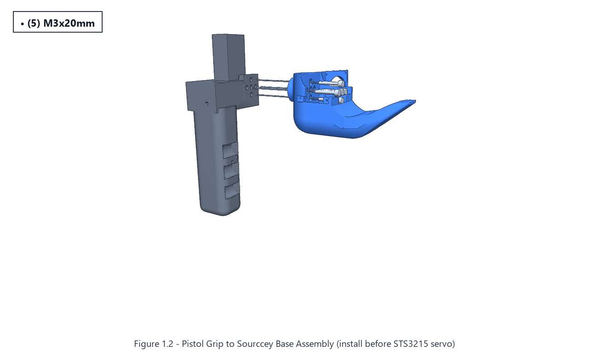
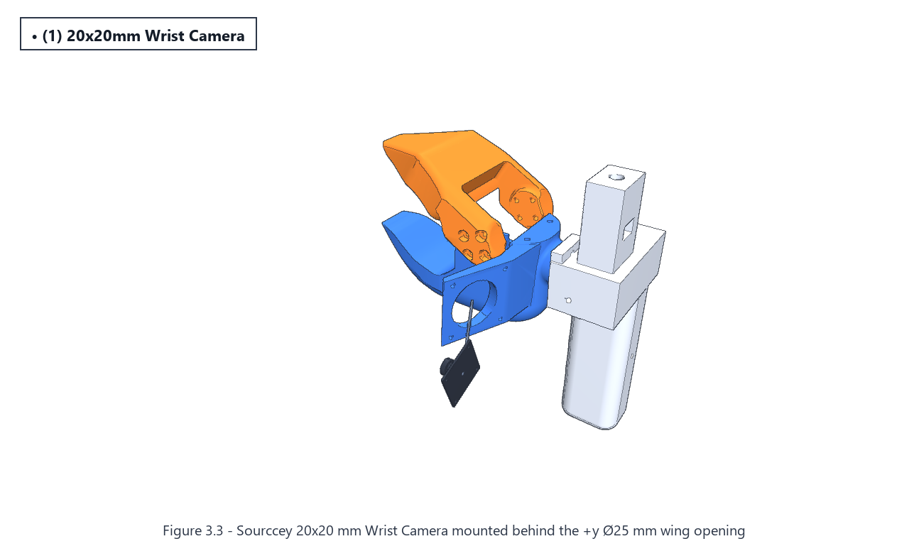
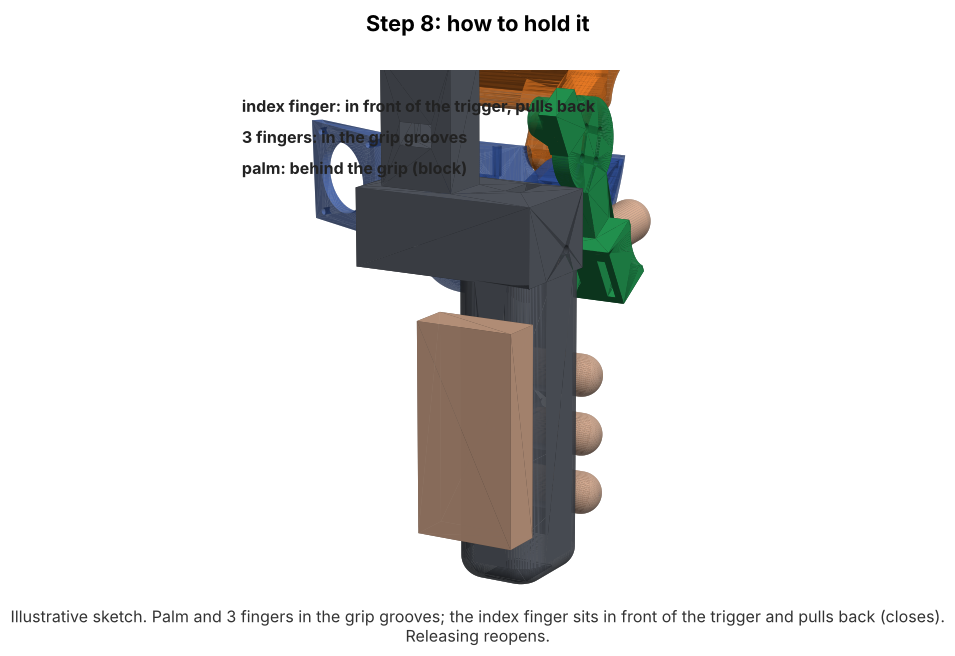

# Step-by-Step Assembly

How to put your **Sourccey UMI** together. All mounting holes match the real Vulcan Robotics Sourccey gripper, so the recorded angle (`q`) and wrist camera view match the robot.

| Time | Difficulty | Printed Weight | Tools Needed |
|---|---|---|---|
| **~45 to 60 min** *(not counting print time)* | Medium | ~187 g (PETG) | Soldering iron (for M3 heat-set inserts) |


---

## Before You Start

### Tools
- [ ] Soldering iron (~220 °C for PETG)
- [ ] Hex keys (2.0 mm / 2.5 mm for M3 screws)
- [ ] Needle-nose pliers (for hooking the return spring)
- [ ] Scissors (for cutting the 15 mm velcro strap)
- [ ] *Optional:* Flush cutters or deburring tool for cleaning print brims

### Parts Checklist
Lay everything out before starting (full specs in [`BOM.md`](../BOM.md)):

| Qty | Part | Step |
|---|---|---|
| 4 | Printed parts: **Base**, **Finger**, **Pistol Grip**, **Trigger Lever** | Steps 1 to 5 |
| 5 | M3 heat-set inserts (for Ø4.2 mm holes) | Step 2 |
| 5 | M3x20 screws (pan head) | Step 3 |
| 4 | M3x16 screws (pan head) | Step 4 |
| 1 | Feetech STS3215 7.4 V servo + horn (torque off / read-only) | Step 5 |
| 1 | M3x70 screw + M3 nut *(or 3 mm smooth rod)* | Step 6 |
| 1 | Extension spring (~15 mm free length, ~0.15 N/mm) *(or rubber band)* | Step 6 |
| 1 | 15 mm velcro strap (~200 mm long) | Step 6 |
| 1 | Sourccey 20x20 mm wrist camera + mount | Step 7 |
| 1 | *Optional:* 1/4-20 x 1-1/4" hex bolt (for the top accessory mount) | Step 7 |
| 2 | Printed 20x20 mm ArUco stickers (`id 0` and `id 1`) | Step 8 |

### Build Order


> [!IMPORTANT]
> **Do Step 3 before Step 5:** bolt the pistol grip onto the base *before* putting the STS3215 servo inside. Once the servo is in place, it can block your hex key from reaching the inner M3x20 screws.

---

## Step 1: Print and Clean the 4 Parts


1. Download and orient the real Sourccey base and finger STLs from Vulcan Robotics:
   ```bash
   python tools/prepare_sourccey_parts.py
   ```
2. Print all **4 parts** in **PETG** (`0.2 mm` layers, `0.4 mm` nozzle, `4 perimeters`, `40%` infill; see [`02-printing.md`](02-printing.md)).
   - **Left arm:** `*_LEFT.stl`
   - **Right arm:** `*_RIGHT.stl`
3. Clean off any brims or supports, especially inside the 5 counterbores on the base and the spring slot in the grip beam.

> [!TIP]
> Test-fit a spare M3 screw through the 4 holes in the trigger lever and the 5 holes in the base before heating up the soldering iron.

---

## Step 2: Press 5x M3 Heat-Set Inserts into the Grip


**Parts:** Printed **Pistol Grip**, `5x` **M3 heat-set inserts**

1. Heat your soldering iron to **~220 °C** (for PETG).
2. Rest one M3 brass insert flat on one of the **5 red-marked Ø4.2 mm holes** on the front face of the grip.
3. Press straight down gently until it sits **flush** with the surface (6 mm deep). Let the heat do the work.
4. Repeat for all 5 holes in the cross, then let it cool for ~2 minutes.

> [!WARNING]
> If an insert goes in tilted, warm it up again, straighten it out, and hold it square while it cools. A crooked insert will bind the M3x20 screws in Step 3.

**Check:** Run a flat edge across the 5-hole face. None of the inserts should stick out.

---

## Step 3: Bolt the Pistol Grip onto the Base



**Parts:** **Pistol Grip** (with inserts), **Sourccey Base**, `5x` **M3x20 screws**

1. Line up the 5-hole cross on the back of the **blue Sourccey base** with the 5 inserts in the **pistol grip**.
2. Put the **5x M3x20 screws in from INSIDE the base** (heads sitting in the Ø6.2 mm counterbores) into the grip inserts.
3. Tighten them evenly in a cross pattern so the two faces sit completely flush.

> [!NOTE]
> If your Sourccey version puts the wrist screws in from the other side, just flip it: put the 5 inserts in the base and drive the screws through the grip.

**Check:** Grab the base and try to twist the pistol grip. There should be zero wobble.

---

## Step 4: Bolt the Trigger Lever onto the Finger


**Parts:** **Sourccey Finger**, **Trigger Lever**, `4x` **M3x16 screws**

1. Place the **green trigger lever** flat against the outer face of the **orange finger's `-y` side** (the side opposite the camera wing).
2. Line up the 4-hole cross with the 4 existing holes on the finger.
3. Fasten with **4x M3x16 screws**. *(If that side already has screws, swap them for ones 6 mm longer to cover the 6 mm lever plate.)*

**Check:** Twist the lever against the finger by hand. They should feel like one solid piece.

---

## Step 5: Install the Servo, Horn, and Finger


**Parts:** **Base + Grip**, **Finger + Lever**, **Feetech STS3215 servo** + horn + servo screws

1. Install the **Feetech STS3215** servo, horn, and **finger + lever** into the base following the official *Sourccey Assembly Manual* (`vulcan-forge/sourccey-hardware`).
2. Keep the servo **unpowered (torque off)** and prefer a **1:147 or 1:191 gear-ratio** STS3215 so it moves smoothly by hand.

**Check:** Move the finger by hand from **`-5°` (closed)** to **`60°` (open)**. The lever should clear the base and grip everywhere (`>= 4 mm` clearance), and at **`~58 to 60°`** the rear tail tab should rest on top of the grip beam.

---

## Step 6: Install the Pin, Return Spring, and Velcro Strap


**Parts:** `1x` **M3x70 screw + M3 nut**, `1x` **Extension spring**, `1x` **15 mm velcro strap (~200 mm)**

1. Push the **M3x70 screw** (or 3 mm smooth rod) through the hole in the grip beam (`x = -42 mm, z = -26 mm`), hooking one end of the **extension spring** onto it inside the channel as it passes through.
2. Put the **M3 nut** on the other end (snug, not crushed).
3. Use needle-nose pliers to hook the other end of the spring into the **Ø3.2 mm hole in the lever's upper tail**.
   - Quick check: the spring should be **short when open (~28 mm at `60°`)** and **stretched when closed (~59 mm at `-5°`)**, always pulling the jaws open.
4. Thread the **15 mm velcro strap** through the two side slots on the concave green trigger pad so it loops comfortably around your index finger.

> [!TIP]
> Unpowered STS3215 gears have some friction. If the spring alone doesn't open the jaws all the way back to `60°`, the velcro strap lets your index finger push the trigger back open easily.

**Check:** Pull the trigger closed and let go at a few angles. Note whether it reopens by itself in [`BENCH_CHECKLIST.md`](../BENCH_CHECKLIST.md).

---

## Step 7: Mount the Sourccey 20x20 mm Wrist Camera



**Parts:** **Sourccey 20x20 mm camera** + robot mount, *(optional)* `1x` **1/4-20 x 1-1/4" hex bolt**

1. **Wrist camera:** mount the **20x20 mm Sourccey camera** behind the **Ø25 mm hole** in the blue base's `+y` side wing using your robot's normal camera mount, aimed at the jaws.
2. **Optional top mount:** leave the top pedestal empty for normal single-camera use. If you ever want to attach an extra accessory later, a **1/4-20 hex bolt** slides in sideways through the rear slot (`x = -51, y = -7, z = 34 mm`).
3. Zip-tie or tape the servo and camera cables cleanly down the back of the pistol grip so they stay out of your way.

---

## Step 8: Add ArUco Stickers and Check the Grip



**Parts:** `2x` **20x20 mm ArUco stickers** (`software/aruco_id0_20mm_300dpi.png` and `software/aruco_id1_20mm_300dpi.png`)

1. Print both markers at **100% scale (300 DPI = exact 20x20 mm)** and stick them on:
   - **`id 0`:** top flat face of the **orange finger**
   - **`id 1`:** outer face of the **blue fixed jaw**
   *(Used by `software/sync_offset.py` if you ever sync an external video stream with the servo.)*
2. **Hold it:**
   - Rest your **palm** behind the dark gray grip and your **middle, ring, and pinky fingers** in the 3 grooves.
   - Put your **index finger** through the velcro loop in front of the concave green pad.
   - Pull back to close; relax (or push slightly) to open.

---

## Step 9: Check Motion and Calibrate


| Trigger State | Joint Angle (`q`) | Jaw Gap *(at 55 mm depth)* | Spring Length |
|---|---|---|---|
| **Released (Open Stop)** | `~60°` | `~82 mm` | `28 mm` |
| **Halfway** | `30°` | `~46 mm` | `42 mm` |
| **Fully Pulled (Closed)** | `-5°` | `~10.6 mm` | `59 mm` |

### What's Next
1. Wire up the STS3215 + 20x20 mm camera and run calibration: [`04-electronics-and-software.md`](04-electronics-and-software.md).
2. Run through [`BENCH_CHECKLIST.md`](../BENCH_CHECKLIST.md) before recording real training datasets.

---

## Quick Troubleshooting

| Issue | Likely Cause | Fix |
|---|---|---|
| Trigger feels stiff or won't snap back to `60°` | Servo gearbox friction or light spring | Keep the **velcro finger strap** snug on your index finger, or try a slightly stronger spring (~0.20 N/mm). |
| M3x20 screws won't catch in the grip | Crooked heat-set insert or leftover support in counterbore | Re-heat and straighten the insert (Step 2), and clear the holes with a 3.2 mm drill bit by hand. |
| Lever rubs the base or stops before `58°` | Loose lever screws or servo horn off by a tooth | Re-seat the servo horn per the Sourccey manual and tighten the 4x M3x16 screws. |
| Wrist camera view is clipped on the edge | Camera board shifted behind the Ø25 mm hole | Re-center the 20x20 mm board behind the opening and check the live preview. |
