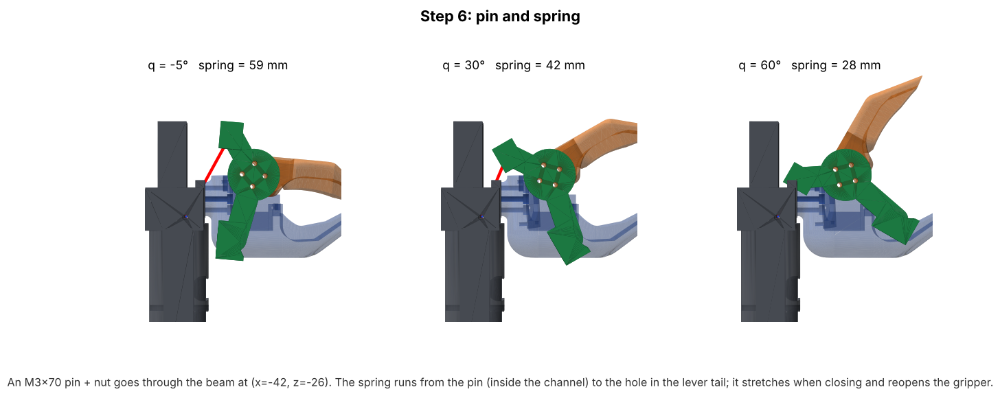

# Step-by-step assembly

Tools: soldering iron (for the inserts), hex keys, needle-nose pliers, scissors (velcro). Time: ~1 hour (printing excluded).

## Step 1: print the 4 parts

## Step 2: M3 inserts in the grip

Press the **5 M3 inserts** into the 5 holes of the face (cross). Iron at ~220 °C, slowly, straight, until flush. If one goes in crooked, heat it and reseat it.

## Step 3: grip onto the base

**5x M3x20**, from INSIDE the base (head in the 6.2 mm counterbore) into the inserts. If the servo blocks access, do this step before installing it. Test: try to twist the grip: there must be no play.
*If in your manual the screws go in the opposite direction, reverse it: inserts in the base and screws through the grip.*

## Step 4: lever on the finger

Bolt the lever onto the outer face of the finger's **-y** side with **4x M3x16** (4-hole cross). If that side already has screws, replace them with ones 6 mm longer. Turn it by hand: the lever must not move relative to the finger.

## Step 5: assembled gripper

Assemble servo STS3215 + horn + finger exactly as in the *Sourccey Assembly Manual* (Vulcan repo). The lever goes on with the finger. Turn the finger from -5° to 60° by hand: it must not scrape the base or the grip, and the trigger must stop at the stop at ~60°.

## Step 6: pin and spring

Pass the **M3x70 pin + nut** through the beam hole (x=-42 mm) and hook one end of the spring on it, inside the channel. The other end goes in the hole in the lever tail. The spring stretches when closing (59 mm) and is short when open (27 mm). Release the trigger at any point: the gripper should open by itself. If it does not open all the way, the servo friction is higher than the spring: use the **velcro strap** on the pad (thread it through the two side slots and close it around your finger).

## Step 7: camera

The Sourccey camera (20x20 mm) sits behind the Ø25 mm opening in the base's side wing, looking at the jaws. Use the mount your robot already uses for it. For the pose tracker (GoPro, tracker) use the 1/4-20 pedestal on top of the grip: the bolt slides in sideways through the rear slot.

## Step 8: how to hold it

Palm and 3 fingers on the grip (it has grooves). The index finger goes in front of the concave pad and pulls back. ArUco markers (`software/aruco_id*.png`): id 0 on top of the finger, id 1 on the fixed jaw.

## Step 9: operation

Released = open (q up to 60°), pulled = closed (q = -5°). Now calibrate and record: `docs/04-electronics-and-software.md`.

Before collecting data do **all** of `BENCH_CHECKLIST.md`.
