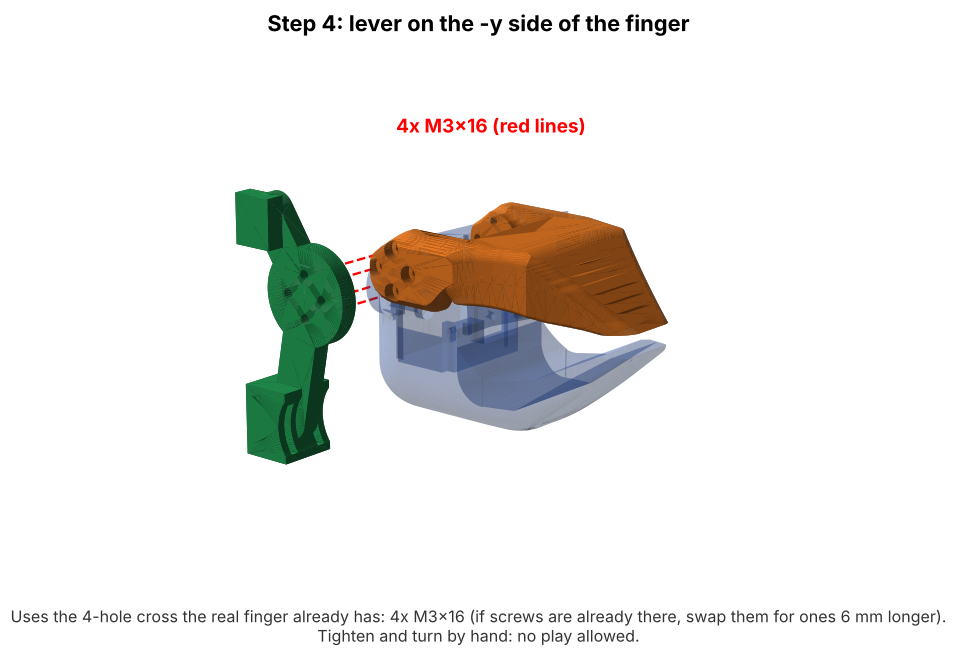
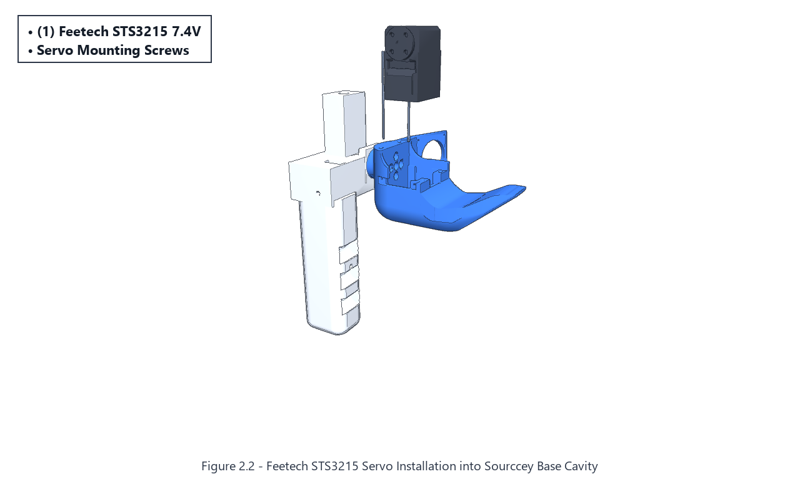
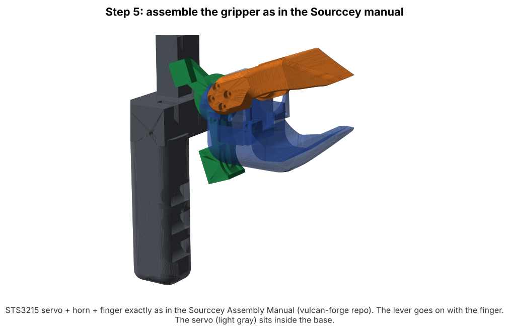
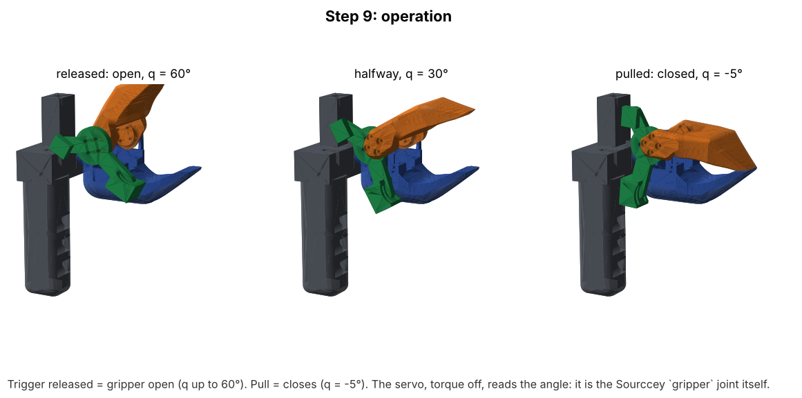

# Sourccey UMI Assembly Manual

Structured in the same stage-by-stage style as the official Vulcan Robotics *Sourccey Assembly Manual*.
Tools needed: soldering iron (~220 °C), M3 hex keys, needle-nose pliers, scissors. Time: ~45 to 60 min (excluding printing).


---

## Stage 1: Printed Parts & Pistol Grip Sub-Assembly

### Materials
| Type | Name | Count |
|---|---|---|
| Part | Sourccey Base (`cad/stl_sourccey/base_sourccey_gripper_LEFT.stl`) | 1 |
| Part | Sourccey Finger (`cad/stl_sourccey/finger_sourccey_gripper_LEFT.stl`) | 1 |
| Part | Pistol Grip (`cad/stl/pistol_grip_LEFT.stl`) | 1 |
| Part | Trigger Lever (`cad/stl/trigger_lever_LEFT.stl`) | 1 |
| Fastener | M3 Heat-Set Insert (Ø4.2 mm hole) | 5 |
| Fastener | M3x20mm Screw (pan head) | 5 |

*(For the right arm, use the `*_RIGHT.stl` files. Print settings: PETG, 0.2 mm layers, 4 perimeters, 40% infill; see [`02-printing.md`](02-printing.md).)*

### Procedure
1. Print and clean all 4 parts as shown in **Figure 1.0**.
2. Press the M3 heat-set inserts flush into the 5-hole cross on the Pistol Grip (~220 °C) as shown in **Figure 1.1**.
   - a. `(5) M3 Heat-Set Insert`
3. Fasten the Pistol Grip to the Sourccey Base from **inside** the base counterbores as shown in **Figure 1.2**.
   - a. `(5) M3x20mm`
   - b. **Do this before installing the STS3215 servo**, otherwise the servo blocks hex-key access. Check that the grip has zero twist play.


---

## Stage 2: Trigger Lever, Servo & Finger Assembly

### Materials
| Type | Name | Count |
|---|---|---|
| Sub-Assembly | Grip + Sourccey Base (from Stage 1) | 1 |
| Part | Sourccey Finger | 1 |
| Part | Trigger Lever | 1 |
| Electronics | Feetech STS3215 7.4 V Servo + Horn (1:147 or 1:191 gear ratio) | 1 |
| Fastener | M3x16mm Screw (pan head) | 4 |

### Procedure
1. Fasten the Trigger Lever flat onto the `-y` outer face of the Sourccey Finger (4-hole cross) as shown in **Figure 2.1**.
   - a. `(4) M3x16mm` *(if screws are already installed on that side, replace them with screws 6 mm longer)*
   - b. Check that the lever and finger move as one solid piece with no play.
2. Insert the **Feetech STS3215 servo** into the central cavity of the Sourccey Base and fasten it with its mounting screws as shown in **Figure 2.2** (connector port facing the rear/open side so the 3-pin bus cable routes cleanly down the grip).
   - a. `(1) Feetech STS3215 7.4V` (prefer 1:147 or 1:191 gear ratio; keep torque OFF).
3. Attach the servo horn and mount the Finger + Trigger Lever sub-assembly onto the STS3215 shaft as shown in **Figure 2.3** (following the official *Sourccey Assembly Manual*).
   - a. Sweep the finger by hand from `-5°` (closed) to `60°` (open): verify zero rubbing and confirm the lever's tail tab hits the open stop at `~58 to 60°`.







---

## Stage 3: Return Spring, Velcro Strap & Wrist Camera

### Materials
| Type | Name | Count |
|---|---|---|
| Fastener | M3x70mm Screw + M3 Nut *(or 3 mm smooth rod)* | 1 |
| Hardware | Extension Spring (~15 mm free length, ~0.15 N/mm) | 1 |
| Hardware | 15 mm Velcro Strap (~200 mm long) | 1 |
| Electronics | Sourccey 20x20 mm Wrist Camera + Robot Camera Mount | 1 |

### Procedure
1. Slide the M3x70mm anchor pin through the grip beam (`x = -42 mm, z = -26 mm`), capture one hook of the extension spring inside the center channel, secure the M3 nut, and hook the other end into the Ø3.2 mm hole in the lever tail as shown in **Figure 3.1**.
   - a. `(1) M3x70mm + M3 Nut`
   - b. `(1) Extension Spring` *(28 mm open at `60°`, stretches to 59 mm closed at `-5°`)*
   - c. Thread the `(1) 15 mm Velcro Strap` through the two side slots on the green trigger pad so your index finger can also assist reopening if servo friction is high.
2. Mount the Sourccey 20x20 mm wrist camera behind the Ø25 mm opening in the `+y` side wing of the blue base using your robot's camera mount, as shown in **Figure 3.2**.
   - a. Route the servo bus cable and camera cable cleanly down the rear of the grip with zip ties.


---

## Stage 4: Electronics & Wiring (Bench Mode OR Portable Wireless Mode)

You can wire the Sourccey UMI in **Mode A (Bench / Tethered)** for the simplest desktop setup, or **Mode B (Portable Wireless)** with a Raspberry Pi Zero 2W + 2S LiPo battery + IMU + physical record button so you can walk around collecting demonstrations without a PC tether.

### Materials (Mode A: Bench / Tethered)
| Type | Name | Count |
|---|---|---|
| Electronics | Feetech / Waveshare USB Bus Servo Adapter (e.g. URT-1) | 1 |
| Electronics | 7.4 V DC Power Supply (2S LiPo or 7.4 V bench adapter) | 1 |
| Cable | 3-Pin Feetech TTL Servo Bus Cable | 1 |
| Cable | USB Data Cable (Adapter -> PC) + Camera USB Cable (Camera -> PC) | 2 |
| Hardware | Zip Ties / Tape (cable management) | 4 |

### Additional Materials (Mode B: Portable Wireless Pack)
| Type | Name | Count |
|---|---|---|
| Electronics | Raspberry Pi Zero 2W + microSD card | 1 |
| Electronics | 2S LiPo Battery (7.4 V, 1000 to 2200 mAh) + power switch | 1 |
| Electronics | 5 V 3A Buck Converter / UBEC (steps 7.4 V down to 5.0 V for Pi) | 1 |
| Electronics | 2-Port Micro-USB OTG Hub (connects Bus Adapter + 20x20 mm Camera to Pi) | 1 |
| Electronics | BNO085 or MPU6050 IMU breakout (I2C, 3.3 V) | 1 |
| Hardware | Momentary Tactile Pushbutton (Start/Stop on grip) + Status LED or Piezo Buzzer | 1+1 |

### Procedure (Mode A: Bench / Tethered)
1. Connect the **3-pin TTL bus cable** from the STS3215 servo to the **USB Bus Servo Adapter** as shown in **Figure 4.1**.
   - a. For **bimanual (dual-arm)** recording, daisy-chain the second UMI's STS3215 (`ID 16`) onto the same 3-pin bus!
2. Connect the **7.4 V power supply** to the bus adapter power terminals (check `+` and `GND` polarity). USB 5 V alone does **not** power the STS3215 encoder.
3. Plug both the USB Bus Servo Adapter and the Sourccey 20x20 mm Wrist Camera into your PC, and zip-tie the cables down the rear of the grip.


### Procedure (Mode B: Portable Wireless Pack)
1. Mount the **2S LiPo battery**, **5 V 3A UBEC**, **USB Bus Servo Adapter**, and **Raspberry Pi Zero 2W** inside a small belt pouch or wrist pack as shown in **Figure 4.2**.
2. Wire power carefully:
   - a. Connect **7.4 V** from the 2S LiPo (through a main switch) to the **USB Bus Servo Adapter** AND to the **5 V UBEC input**.
   - b. Connect the **5.0 V UBEC output** to the Raspberry Pi Zero 2W (`5V` and `GND`). **Never connect 7.4 V directly to the Pi.**
3. Connect the **USB Bus Servo Adapter** and the **20x20 mm Wrist Camera** to the Pi Zero 2W via the Micro-USB OTG hub.
4. Mount the **BNO085 / MPU6050 IMU** flat on the grip beam (with double-sided tape or zip ties) and wire it to the Pi's I2C1 header (`3.3V`, `GND`, `SDA -> GPIO 2`, `SCL -> GPIO 3`).
5. Mount the **Start/Stop pushbutton** on the rear/side of the pistol grip (`GPIO 17 -> GND`) and the **Status LED / piezo buzzer** (`GPIO 27 -> GND`, with a 330 ohm resistor if using an LED).
6. Run calibration and launch the portable node or Studio web app:
   ```bash
   python software/sts_angle.py calibrate --port /dev/ttyACM0 --id 6
   python software/portable_node.py --imu bno085
   ```


---

## Stage 5: Ergonomics, ArUco Stickers & Verification

### Materials
| Type | Name | Count |
|---|---|---|
| Hardware | Printed 20x20 mm ArUco Marker (`software/aruco_id0_20mm_300dpi.png`) | 1 |
| Hardware | Printed 20x20 mm ArUco Marker (`software/aruco_id1_20mm_300dpi.png`) | 1 |

### Procedure
1. Stick `id 0` on the top flat face of the orange finger and `id 1` on the outer face of the blue fixed jaw (print at 100% scale / 300 DPI).
2. Hold the UMI as shown in **Figure 5.0**: palm behind the grip, 3 fingers in the grip grooves, index finger in the velcro loop on the green trigger pad.
3. Verify the full sweep shown in **Figure 5.1**: released = open (`q = 60°`, ~82 mm gap), pulled = closed (`q = -5°`, ~10.6 mm gap).
4. Complete [`BENCH_CHECKLIST.md`](../BENCH_CHECKLIST.md) before recording real training datasets (full software/web-app guide in [`04-electronics-and-software.md`](04-electronics-and-software.md)).



