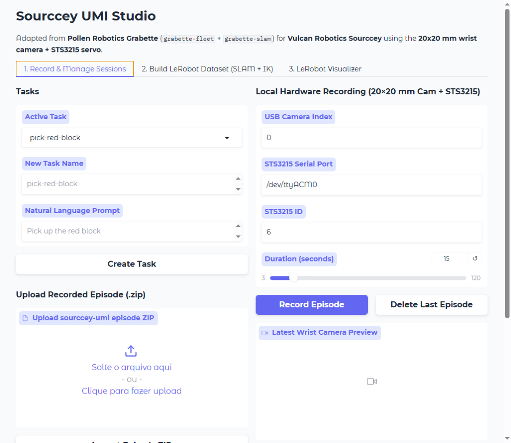
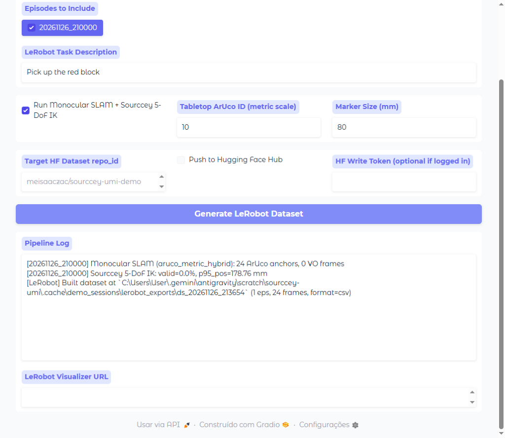

# Sourccey UMI Studio

A simple web app and Hugging Face Space modeled after Pollen Robotics' [`grabette-fleet`](https://huggingface.co/spaces/pollen-robotics/grabette-fleet) and [`grabette-slam`](https://huggingface.co/spaces/pollen-robotics/grabette-slam), adapted for **Vulcan Robotics Sourccey UMI** using just the **20x20 mm Sourccey wrist camera + Feetech STS3215 servo**.

> Note: this project is vibe coded and still being improved, so expect updates and fixes over time.

## What it does
1. **Record & Sessions:** create tasks, record from your local USB camera + STS3215 (when running locally), or upload episode `.zip` files (when running on Hugging Face Spaces).
2. **Monocular SLAM + 5-DoF IK:** recovers metric 6-DoF pose from the 20x20 mm camera using a printed tabletop ArUco marker (`cv2.solvePnP`) + ORB visual odometry (`software/mono_slam.py`), then solves 5-DoF IK on the real Sourccey URDF (`software/build_episode.py`).
3. **LeRobot Export & Visualizer:** builds a LeRobot dataset (`software/grabette_lerobot.py`), pushes it to your Hugging Face account, and embeds [`lerobot/visualize_dataset`](https://huggingface.co/spaces/lerobot/visualize_dataset).




## Run locally
```bash
pip install -r space/requirements.txt
python space/app.py
# Open http://localhost:7860
```

## Deploy on Hugging Face Spaces
Create a new **Docker** Space on Hugging Face and push this repo using `space/Dockerfile`.
